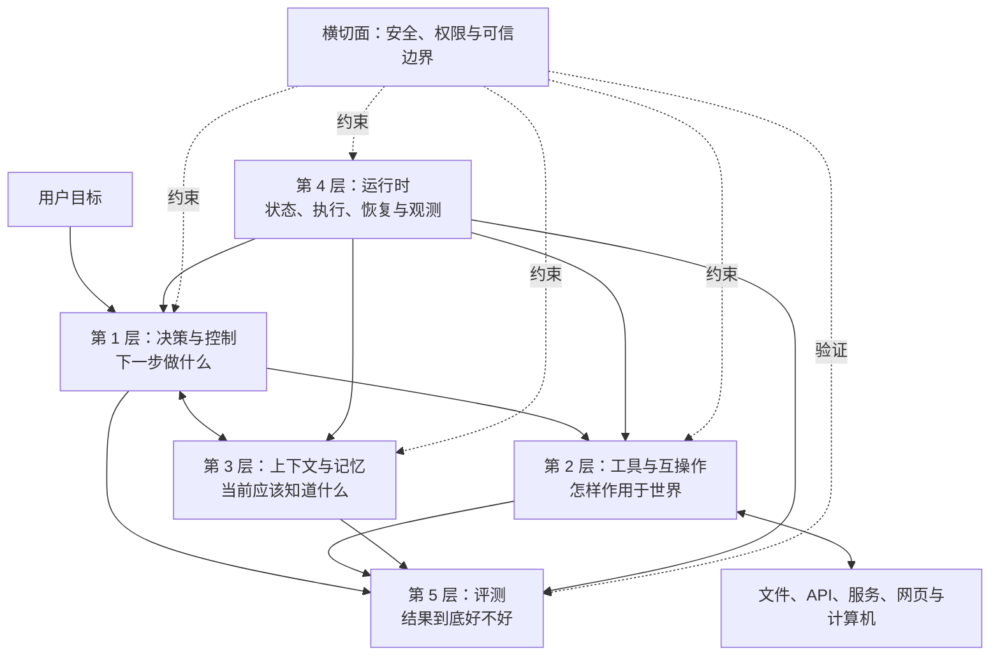

# Astrion Agent 技术愿景

> **以智慧，奔赴星海。**  
> *Intelligence bound for the stars.*

文档状态：持续演进（Living Document）  
首次确立：2026-10-30  
适用范围：Astrion Agent 的长期架构方向、技术边界和演进顺序

## 1. 我们想构建什么

Astrion Agent 不以堆叠最多的 Agent 概念为目标。我们希望构建一个：

- **可理解**的 Agent：模型为什么行动、Python 为什么执行、结果怎样进入下一轮，都能沿代码和事件记录解释；
- **可验证**的 Agent：是否完成任务由外部结果和独立裁判判断，而不是相信 Agent 的自述；
- **可控制**的 Agent：工具、文件、网络、代码执行和长期记忆都有明确权限边界；
- **可恢复**的 Agent：长任务发生中断后能够确认状态并安全继续，而不是从头猜测；
- **可演进**的 Agent：保持一个小而稳定的核心，再通过协议、适配器和插件逐步接入新能力。

它以科学为底色：区分事实、假设和指标；以浪漫为想象：允许能力不断向外延伸；
以乐观为行动力：每一次演进都落实为可运行、可测试、可复现的工程增量。

## 2. 五层技术路线



五层不是五个互不相干的目录，而是五种不同的工程责任。一个技术可以跨层，但必须说明它在每一层承担什么责任。

### 第 1 层：决策与控制

这一层回答：**面对当前目标和观察，Agent 下一步应该做什么？**

| 时间 | 路线 |
|---|---|
| 已实现 | 以 ReAct 为最小基线；模型产生结构化工具调用；工具结果进入下一轮；以 `finish`、无工具调用和步数上限区分结束原因 |
| 下一阶段 | 把循环显式化为可检查的状态机；为 planner、replan 和基于外部证据的修正保留接口；明确每种结束状态的语义 |
| 中期 | 对步骤可预判的任务按需加入 Plan-and-Execute；只有在测试、环境结果或 verifier 提供新证据时才触发反思和修正 |
| 长期探索 | 在具有有限分支和强 verifier 的任务上尝试搜索式推理；在适合组合计算的任务上引入沙箱化 CodeAct |

原则：

1. 不要求模型暴露完整内部思维链；系统需要的是可执行的决定、必要的简短理由和可审计的结果。
2. ReAct 是默认基线，不是唯一循环。新范式必须通过评测证明收益后才进入默认路径。
3. `finish` 只是 Agent 发出的完成信号，不是任务正确性的证明。
4. CodeAct 是一种动作表达方式，不会全面替代结构化工具调用。高风险、边界清晰的操作优先使用类型明确的工具。

### 第 2 层：工具与互操作

这一层回答：**Agent 怎样安全、结构化地作用于外部世界？**

| 时间 | 路线 |
|---|---|
| 已实现 | 本地 function calling；工具说明与 Python 实现分离；统一回填 tool result；沙箱路径检查；评测可以按任务注入工具定义 |
| 下一阶段 | 提炼统一的 `ToolSpec`、`ToolCall`、`ToolResult` 和错误语义；增加能力声明、权限检查、超时与可观测字段 |
| 中期 | 通过适配器接入 MCP；让 Skills 承担流程、脚本和参考资料的按需加载；为受限代码执行提供真正隔离的执行器 |
| 长期探索 | 把 Computer Use 作为没有稳定 API 时的后备能力；在独立 Agent 系统之间有真实协作需求后再接入 A2A |

建议的能力优先级是：

```text
结构化 API / function calling
    → MCP 工具和资源
    → 沙箱化代码执行
    → Computer Use
```

这不是绝对顺序，但越向后，环境不确定性、权限风险和验证成本通常越高。

Skills 是知识与流程的包装方式，不会自动赋予工具或权限；MCP 解决发现和调用，不自动证明远端工具可信；
A2A 面向独立 Agent 系统之间的任务、消息和产物交换，不等于进程内创建一个子 Agent。

### 第 3 层：上下文与记忆

这一层回答：**在有限上下文中，Agent 当前应该看到什么，又应该记住什么？**

| 时间 | 路线 |
|---|---|
| 已实现 | 独立 `Memory`；完整保存工具调用与结果的配对；字符预算触发的旧轮次压缩；摘要进入后续上下文；会话序列化与恢复 |
| 下一阶段 | 把上下文组装、消息存储和压缩策略解耦；补强压缩失败语义；使用更接近真实模型限制的 token 预算；记录信息来源 |
| 中期 | 把检索作为可调用能力，引入 Agentic RAG；建立短期工作记忆、会话记忆和长期记忆的分层接口 |
| 长期探索 | 建立显式写入、可审计、可失效的长期记忆；引入 tombstone 和替代关系；用子 Agent 的上下文隔离处理复杂任务 |

长期记忆尚未实现。未来的记忆至少需要包含来源、创建时间、更新时间、有效期、状态和替代关系。
被 tombstone 标记的记忆默认不得重新参与检索；只有审计路径能够查看它，防止已经失效或被删除的信息“复活”。

Compaction 和长期记忆是两件事：前者解决当前窗口太长，后者解决跨任务的信息保存与检索。
Subagent 也不只是记忆技巧，它同时涉及决策编排、运行时隔离和评测归因。

### 第 4 层：运行时

这一层回答：**怎样让 Agent 跑得久、跑得稳，并在出错后知道发生了什么？**

| 时间 | 路线 |
|---|---|
| 已实现 | CLI harness；步数限制；单次请求超时；token 计量；Run/Step/Event v1 旁观日志；原子会话保存；通用会话恢复；BFCL 专用安全断点续跑 |
| 下一阶段 | 把决策循环显式化为状态转换；让评测稳定消费 Event v1；支持取消、分类重试、退避、幂等约束和资源预算；设计事件与 checkpoint 的关联 |
| 中期 | 把 checkpoint、事件日志与副作用记录组合为通用可恢复执行；增加并发控制、速率限制、密钥管理和人工批准节点 |
| 长期探索 | 在确有长周期工作流需求时，演进为基于持久事件历史和确定性重放的 durable execution；支持任务调度和分布式 worker |

当前的 session resume 和 BFCL resume 是可恢复执行的基础，但还不是 Temporal 意义上的通用 durable execution。
真正的 durable execution 不只保存一个 JSON；它还要定义哪些逻辑可以重放、哪些副作用必须幂等、外部结果如何被持久记录。

Event v1 已能回答哪次模型调用做了什么决定、调用了哪个工具、产生了什么结果，以及消耗多少时间和 token。
它当前仍是旁观日志，不参与 checkpoint 恢复或副作用重放；这条边界要在设计幂等与 durable execution 前保持明确。

### 第 5 层：评测

这一层回答：**我们怎样知道一次修改真的让 Agent 变好了？**

| 时间 | 路线 |
|---|---|
| 已实现 | 离线单元测试；赛后评测；可注册裁判；单任务与总报告；成功率、运行时间和 token 统计；BFCL 官方 harness 集成 |
| 下一阶段 | 统一 outcome、trajectory、efficiency、reliability 和 safety 五类评测接口；建立版本对比和回归门槛；让失败原因可聚合 |
| 中期 | 按能力接入多轮工具任务、检索任务、代码任务和安全攻击集；用固定集、私有集和动态集共同降低榜单过拟合 |
| 长期探索 | 在支持网页、桌面和多 Agent 能力后，再分别接入 WebArena、OSWorld、A2A 场景和端到端真实工作流评测 |

评测坚持三个原则：

1. **赛后评判**：默认在 Agent 运行结束后，根据完整运行事实进行评判；运行中的组件若改变执行，应被视为控制器或 guardrail，而不是纯裁判。
2. **外部可验证**：优先检查文件、数据库、测试、页面或系统状态，不相信 Agent 自己声称“已完成”。
3. **多维度报告**：正确率之外，同时记录时间、token、费用、工具调用、重试、稳定性、安全违规和可复现性。

不同 benchmark 只覆盖不同切面。BFCL 能检验工具调用，不代表已经检验长任务、浏览器操作、长期记忆或真实业务可靠性。
单一总分不能代表完整 Agent 能力。

## 3. 横切面：安全、权限与可信边界

安全不是开发结束后附加的第六层，而是贯穿五层的设计约束。实现可以分阶段推进，但接口从现在开始就要保留边界。

| 范围 | 核心约束 |
|---|---|
| 决策 | 用户输入、网页内容、文件内容和工具返回都可能包含恶意指令；数据不能自动升级为系统指令 |
| 工具 | 最小权限、参数校验、能力声明、超时、输出限制；高风险操作需要明确授权或人工确认 |
| 记忆 | 保存来源和信任级别；防止提示词攻击被永久写入；失效和 tombstone 必须影响后续检索 |
| 运行时 | 文件、进程、网络、密钥和资源使用由代码与沙箱强制限制，不能只靠 prompt 请求模型自律 |
| 评测 | 建立越权、注入、数据泄漏、拒绝服务和危险副作用样例，安全结果与任务成功率分开报告 |

安全的长期目标不是“模型永不犯错”，而是即使模型做出错误或受攻击的决定，运行时仍能限制影响范围、留下证据并安全恢复。

## 4. 共同工程原则

### 4.1 模型负责提议，运行时负责执行和授权

模型可以选择工具和参数，但真正的文件读取、网络访问、代码执行和权限判断必须由确定性的程序完成。

### 4.2 消息、事件和产物都要结构化

`Message` 连接模型上下文，`Event` 记录运行事实，`Artifact` 表示任务产物。三者用途不同，不用一段终端文本同时承担全部责任。

### 4.3 先有可验证的最小闭环，再增加自治程度

每增加一种决策范式、工具协议或记忆机制，都应先定义失败语义、观测方式和评测方法。不能测量的能力不进入默认主路径。

### 4.4 核心保持小，扩展通过稳定接缝进入

主循环、工具契约、上下文组装、运行事件和评测协议是核心。MCP、A2A、CodeAct、Computer Use 和外部裁判通过适配器或插件接入。

### 4.5 不用 prompt 代替安全边界

提示词可以说明规则，但文件边界、工具权限、网络权限、资源限制和高风险批准必须由运行时代码执行。

### 4.6 用评测决定复杂度是否值得

复杂方案只有在目标任务上稳定提高正确性、效率、安全性或可恢复性时才被保留。论文中的提升不自动等于 Astrion 的提升。

## 5. 推荐演进顺序

技术路线不是同时开工的功能清单。当前建议按以下顺序推进：

1. **稳定核心契约**：明确决策状态、工具调用、工具结果、结束状态和错误分类。
2. **逐步提升运行事实的地位**：Event v1 已统一普通运行与评测的 trace；下一步设计它与 checkpoint 的关联，不直接跳到副作用重放。
3. **完善上下文管理**：拆分存储、选择、压缩与组装，并让 token 预算和失败语义可测试。
4. **升级插件式评测**：按结果、轨迹、效率、稳定性和安全性组织裁判，并建立版本回归对比。
5. **接入 MCP 与 Skills**：在内部工具契约稳定后扩展外部工具和流程知识。
6. **建设通用可恢复运行时**：处理副作用、幂等、重试、取消、预算和人工批准。
7. **引入长期记忆**：先定义写入、检索、失效、tombstone 与审计，再选择存储技术。
8. **按证据扩展行动空间**：依次评估 CodeAct、Computer Use、Subagents 和 A2A，而不是为了概念完整而接入。

每一步都应回答四个问题：

```text
它解决了什么已经观察到的问题？
失败时会发生什么？
怎样测量它比原来更好？
怎样关闭或回退这项能力？
```

## 6. 当前边界

截至本文首次确立时，Astrion 是一个可读、可运行、可评测的单 Agent 系统。它已经拥有 ReAct 工具循环、
本地沙箱工具、上下文压缩、会话恢复、结构化运行报告、插件式赛后裁判和 BFCL 集成。

它目前**不等于**：

- 通用长期记忆系统；
- Temporal 级 durable workflow engine；
- 任意代码安全执行平台；
- MCP 或 A2A host；
- 浏览器或桌面操作 Agent；
- 多 Agent 编排框架；
- 已经解决提示词注入的安全系统。

这些不是缺陷清单，而是清晰的技术边界。Astrion 将在核心契约和评测证据支持下逐步越过这些边界。

## 7. 文档如何维护

- 本文记录稳定的方向、边界和演进原则，不记录每日实现细节。
- 已完成的实现过程、学习问答和验证结果继续写入 `report.md`。
- 当前可运行命令和代码使用方法写入 `astrion-agent/README.md`。
- 重大架构取舍以后应补充独立 ADR；若实现与本文不一致，应明确修改本文或记录有意偏离的原因。

技术愿景允许演进，但不应静默漂移。每次改变路线，都要留下原因、证据和日期。

## 8. 参考坐标

这些资料用于理解技术方向，不代表 Astrion 必须完整复刻其实现：

- [ReAct](https://arxiv.org/abs/2210.03629)
- [ReWOO](https://arxiv.org/abs/2305.18323)
- [Reflexion](https://arxiv.org/abs/2303.11366)
- [CodeAct](https://arxiv.org/abs/2402.01030)
- [Model Context Protocol](https://modelcontextprotocol.io/)
- [Agent2Agent Protocol](https://a2aproject.github.io/A2A/)
- [Agent Skills](https://agentskills.io/)
- [MemGPT](https://arxiv.org/abs/2310.08560)
- [Temporal](https://docs.temporal.io/)
- [τ-bench](https://arxiv.org/abs/2406.12045)
- [WebArena](https://arxiv.org/abs/2307.13854)
- [OSWorld](https://os-world.github.io/)
- [GAIA](https://arxiv.org/abs/2311.12983)

