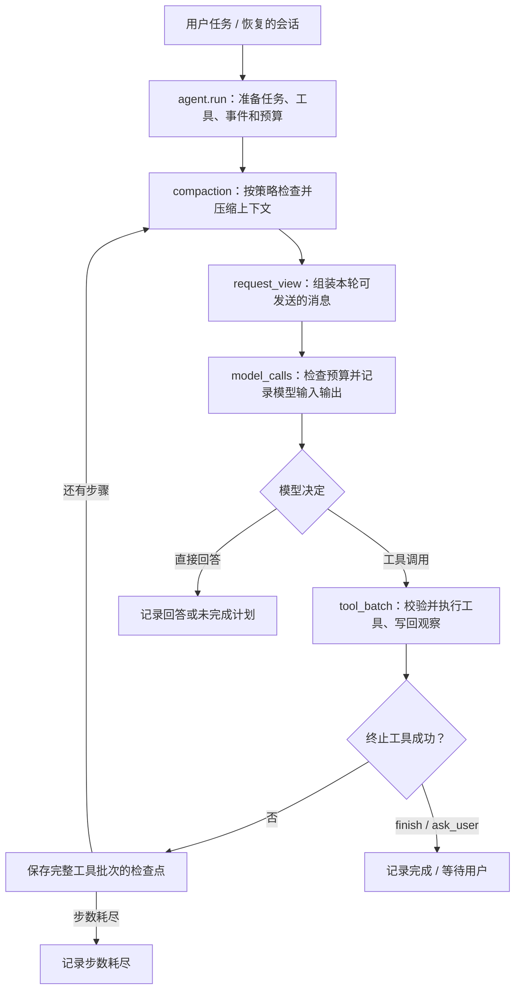

# Astrion Agent 主循环

`agent.py` 是现有 CLI 和 Python 入口。`agent.run(...)` 负责启动一次运行、准备工具和会话状态，然后按步骤调度模型与工具；研究模式的主、子 Agent 也通过这个入口运行。

图表示主要流程；研究模式可将预算内最后一轮设为只读收尾，此轮不提供工具。模型输出不等于已执行动作：执行器先验证工具名称和参数，实际执行后才把结果作为 `tool` 消息写回。

| 文件 | 职责 |
|---|---|
| `agent.py` | 保留 `run()`、模型客户端和 CLI；组织运行状态、计划与步骤的衔接。 |
| `agent_runtime/compaction.py` | 判断是否需要五层压缩或显式启用的 SS 重建，记录压缩事件。 |
| `agent_runtime/request_view.py` | 在预算允许时，为本次请求恢复最新的工具正文；不改写档案。 |
| `agent_runtime/model_calls.py` | 管理本次运行的模型调用编号、输入预算、请求快照和成功/失败事件。 |
| `agent_runtime/tool_batch.py` | 执行一批工具调用，记录结果并写回；成功终止后，后续调用标为跳过。 |
| `memory.py` / `context_history.py` | 分别保存当前消息与压缩视图、长期执行历史和快照。 |
| `tooling.py` / `tools/` | 分别定义工具契约与验证、各项工具的声明和具体实现。 |

依赖方向是 `agent.py` 调用运行时组件；这些组件不反向导入 `agent.py`。运行中每个 Agent 有自己的记忆和事件身份，运行时组件不会使用一个跨运行共享的调用计数器。

结束状态由主循环统一确定：`completed` 表示成功调用 `finish`，`needs_input` 表示调用 `ask_user`，`no_tool_call` 表示模型直接回答，`incomplete_plan` 表示计划仍有待办，`step_limit` 表示步数耗尽。`completed` 不等于独立评测通过；每个工具批次全部写回后才保存运行中的检查点。

此次整理保留原有 `agent.run`、`agent.ChatLLM`、CLI 和工具注入入口，事件格式与上下文预算策略不变。`agent.recent_tool_request_view` 仍可导入。请求视图目前仍通过 `Memory` 的内部表示构建，本次没有改变持久化格式或宣称该耦合已经消除。
