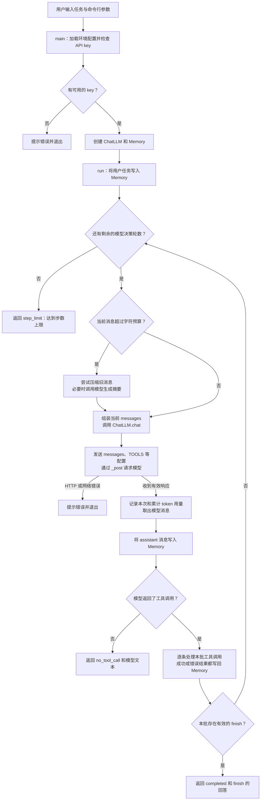
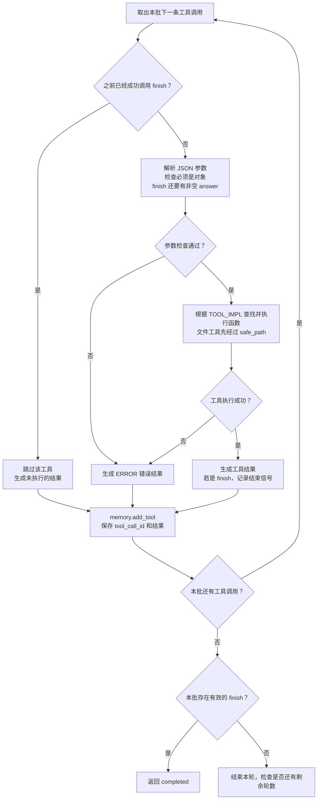
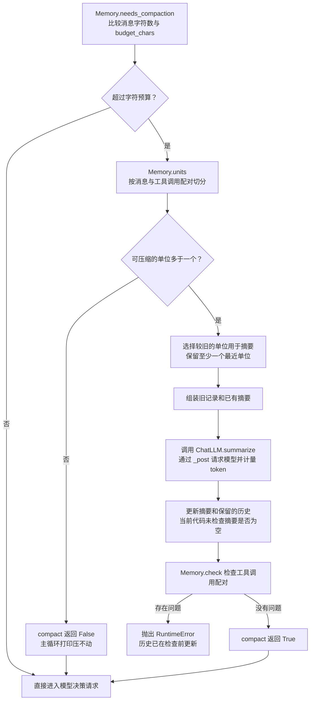
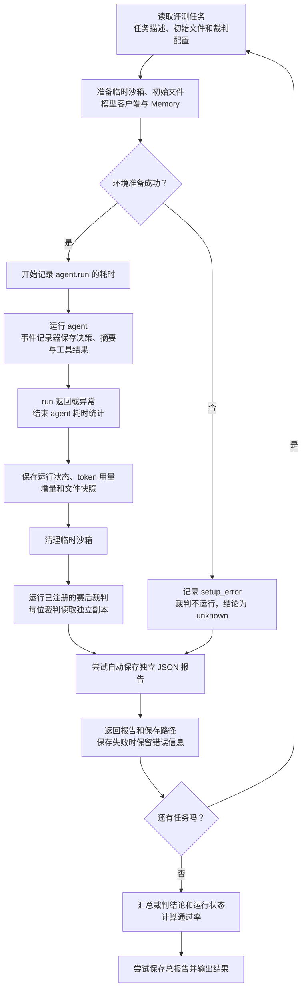

# Toy Agent 项目实现与学习记录

记录日期：2026-10-30（Asia/Shanghai）  
项目根目录：`/Users/apple/Desktop/科研/Multi Agent`  
记录范围：项目初始版本、记忆模块、学习问答、token 计量和赛后评测层的实现及验证。

## 1. 记录依据与项目目标

这个项目的目标是构建一个能完整看懂的最小 agent，先理解单个 agent 的运行机制，再逐步完善功能。当前实现仅使用 Python 标准库，没有引入 agent 框架。

学习者已经能看懂 Python 的函数、字典和循环，但此前没有编写 agent 的经验。双方约定每次只推进一个小步骤，边构建边讨论。

这份记录使用三类依据：

1. Git 已有提交，用来确认本次对话前发生过的代码变化。
2. 当前源码和文件内容，用来说明现有实现及边界。
3. 本次对话与实际执行结果，用来记录学习问答、token 计量的需求和实现过程。

本次对话开始时，最小 agent 和独立记忆模块已经存在。因此，前两个阶段根据 Git 和代码还原，不补写无法确认的早期讨论。当前文件夹虽然名为 `Multi Agent`，实际代码仍是单 agent，尚未实现多个 agent 的协作。

## 2. 项目演进时间线

| 阶段 | 时间与依据 | 已确认的变化 |
|---|---|---|
| 初始最小 agent | 2026-10-30 00:20:09，提交 `a48c7f0` | 创建工具、工具说明、路径限制、模型客户端、执行循环、命令行入口和示例数据；消息历史直接放在 `run()` 的列表中 |
| 独立记忆模块 | 2026-10-30 00:26:33，提交 `8bd8297` | 新增 `memory.py`；增加按完整工具调用轮次压缩、摘要请求和字符预算；抽出共用 HTTP 方法 `_post()` |
| 本次机制学习 | 本次对话 | 讨论工具选择、模型与 Python 的分工、工具结果回传、结构化消息；完成 5 道自测及追问 |
| Token 计量 | 本次对话，已写入工作区 | 在模型客户端统一统计服务端返回的用量，增加决策和摘要标签、未知用量处理、5 项离线测试及 README 说明 |
| 项目报告 | 本次对话 | 按要求在项目根目录新增本文件，记录整个项目截至目前的实现和问答摘要 |
| 结束处理与结构化结果 | 本次对话，见第 12 节 | 明确三种正常结束状态，补齐 `finish` 消息，检查工具参数，增加主循环离线测试 |
| 赛后评测层 | 本次对话，见第 13 节 | 引入评测任务、隔离运行记录、耗时统计和可注册裁判；不设置评测时间上限 |
| 自动报告与评测样例 | 本次对话，见第 14 节 | 每个评测任务自动保存 JSON 报告，并把内置任务扩充为 10 个 |
| 批量通过率总报告 | 本次对话，见第 15 节 | 支持汇总全部样例的裁判结果、通过率、运行状态和单任务报告路径 |

报告初稿编写时，token 计量相关改动尚未提交；之后与报告一起提交为 `5d4df3d`。第 12 节记录这之后的修改。

## 项目运行流程图（当前版本）

以下四张图根据当前代码绘制。先看 agent 的整体循环、工具调用和记忆压缩，再看批量赛后评测。图中描述的是当前行为；模型实际选择什么工具、会不会调用 `finish`，取决于每次模型响应。

### 一、从用户任务到结束



- `steps` 记录主循环完成的模型决策调用次数；摘要调用也消耗 token，但不增加 `steps`。
- `completed` 表示模型成功调用了 `finish`，程序没有自动检查最终文件是否符合任务要求。
- 当前在压缩后会继续执行模型决策请求，即使保留下来的消息仍可能超过字符预算；这不是严格的 token 上限。
- 图中模型请求的异常分支列出代码明确处理的 HTTP 和网络错误；摘要请求发生类似错误时同样可能退出。模型响应格式等其他异常仍可能向上抛出。

### 二、一批工具调用怎样处理



`TOOLS` 是随决策请求发送给模型的工具说明；`TOOL_IMPL` 是 Python 中的“名称 → 函数”映射。图中的“参数检查”是执行前的基础检查；函数还可能因为缺参、多余参数或其他原因抛出异常。

有效的 `finish` 后，本批后续调用虽然跳过，仍各自记录一条结果，保持调用和结果配对。如果 `finish` 参数无效，程序会记录错误，它不算有效结束信号，因此本批后续调用仍会按通常规则处理。

### 三、记忆压缩怎样影响后续请求



`for_model()` 在每次决策前组装原始系统提示、已有摘要（如果非空）和当前历史。摘要请求与普通决策请求共用 `_post()`，因此两者的有效 `usage` 都计入同一个 `ChatLLM` 实例的已知累计；摘要请求本身不携带 `TOOLS`。

图中也标出了当前待完善的地方：空摘要可能造成旧信息丢失；一次压缩后仍可能超过字符预算。`budget_chars` 是触发压缩的字符预算，服务端返回的 `usage` 是实际 token 统计，两者用途不同。

例如，对于“读取 `data.txt`、计算数字之和并写入文件”的任务，模型可能依次请求 `read_file`、`calculator`、`write_file` 和 `finish`。这是可能的执行路径，具体动作顺序以实际模型响应为准。

### 四、赛后评测层怎样工作



任务参考答案供裁判使用，评测器只把任务文本和初始文件交给 agent。agent 的运行时间包括模型请求、工具执行、摘要和同步记录；准备沙箱、生成快照和裁判评测不计入。当前不设置评测时间上限；原有 agent 步数限制与单次 HTTP 超时仍然存在。

## 3. 当前文件组织

```text
Multi Agent/
├── .env                       # 本地 API 配置，不记录密钥内容
├── .gitignore                 # 忽略密钥、Python 缓存等文件
├── report.md                  # 本报告
└── toy-agent/
    ├── agent.py               # 工具、模型客户端、token 计量、主循环和可选事件记录
    ├── memory.py              # 消息记录、分轮、自检、摘要压缩
    ├── README.md              # 运行方法与设计说明
    ├── test_token_usage.py    # 模拟 API 响应的计量测试
    ├── test_run_lifecycle.py  # 模拟模型响应的主循环测试
    ├── test_evaluation.py     # 评测层离线测试
    ├── test_evaluation_summary.py # 通过率及总报告测试
    ├── eval_reports/          # 首次评测后生成的报告目录，不纳入 Git
    ├── evaluation/
    │   ├── __init__.py        # 导出评测运行器与裁判注册表
    │   ├── __main__.py        # 评测命令行入口
    │   ├── cases.json         # 示例评测任务
    │   ├── runner.py          # 隔离运行、耗时与运行记录
    │   ├── judges.py          # 裁判注册及内置文件裁判
    │   ├── suite.py           # 汇总各样例结果和通过率
    │   └── reporting.py       # 自动生成不重名的 JSON 报告
    └── sandbox/
        ├── data.txt          # 演示任务输入
        └── result.txt        # 演示结果文件
```

报告中的文件和符号均以这个项目根目录为定位基准。下面分阶段说明它们如何组成一个 agent。

## 4. 第一阶段：把模型、工具和循环连接起来

### 4.1 先明确模型与程序的分工

模型根据任务、工具说明和历史结果，生成下一步的工具调用请求。Python 程序解析请求、执行函数，再把结果发送给下一轮模型调用。

```text
用户任务
  → 模型读取任务与工具说明
  → 模型生成工具名和参数
  → Python 查找并执行函数
  → 程序把结果写入消息历史
  → 下一轮模型根据更新后的历史继续决策
```

模型无法凭空知道本地文件内容。它需要先请求文件工具，随后从工具结果消息中获得内容。当前实现没有让模型直接执行任意 Python 代码。

### 4.2 把外部能力写成普通函数

项目提供四个业务工具和一个终止信号，共五项工具说明：

| 名称 | 作用 | 当前实现要点 |
|---|---|---|
| `list_files` | 列出文件和子目录 | 先检查路径，再遍历目录并返回 JSON 字符串 |
| `read_file` | 读取文本文件 | UTF-8 读取；超过 8000 字符时返回截断后的内容及提示 |
| `write_file` | 写入文本文件 | 覆盖写入；按需创建父目录；内容超过 100000 字符时报错 |
| `calculator` | 计算算术表达式 | 用 `ast` 解析并只执行允许的节点，支持基本运算和括号 |
| `finish` | 表达任务完成 | 主循环验证 `answer`、记录工具结果，处理本批剩余调用后返回 |

计算器用运算符映射和递归求值实现，不使用通用 `eval()`。表达式长度上限为 200 字符，幂运算的指数绝对值上限为 100。这些是教学实现中的局部限制，不代表已经构成完整的资源隔离。

本次学习中实际执行过：

```python
calculator("2 + 3")
```

返回：

```json
{"expression": "2 + 3", "result": 5}
```

这是一次直接的 Python 函数调用，用于先理解工具本身，没有调用真实模型。

### 4.3 把工具说明与实际执行分开

`TOOLS` 是发给模型的工具说明，包含名称、用途、参数结构和必填字段。`TOOL_IMPL` 是程序内部的名称到函数的映射。

模型请求计算时，解析后的数据可以表示为：

```python
name = "calculator"
args = {"expression": "2 + 3"}
```

程序中的执行语句是：

```python
observation = TOOL_IMPL[name](**args)
```

这相当于执行 `calculator(expression="2 + 3")`。模型知道工具说明，并不意味着 Python 中一定存在对应函数；两份清单必须保持一致。

### 4.4 在执行层限制文件路径

文件工具都会先调用 `safe_path()`：

```python
root = (sandbox if sandbox is not None else SANDBOX).resolve()
target = (root / raw).resolve()
if target != root and root not in target.parents:
    raise PermissionError(f"路径越界，只允许访问 {root}")
return target
```

这段代码先解析路径，再检查目标是否位于允许目录内。例如，尝试读取 `../.env` 会在正常的路径检查中被拒绝。默认使用项目的 `SANDBOX`；评测运行器可以为单次运行传入独立目录。系统提示词也要求只操作沙箱，但执行层的检查负责实际约束。

这里的 `sandbox/` 是应用代码规定的文件访问范围，并非操作系统级隔离容器。

### 4.5 接入真实模型服务

`ChatLLM` 使用 `urllib.request` 发起 HTTP 请求。请求中包括模型名称、`messages`、`TOOLS` 和 `tool_choice="auto"`。响应中的 `choices[0].message` 返回给主循环处理。

配置实现包含：

- 从脚本目录及最多三级父目录查找 `.env`，近处文件优先。
- 已有环境变量不被 `.env` 覆盖。
- `--model`、`--base-url` 优先于环境变量和 `.env` 中的对应设置。
- 密钥依次查找 `AGENT_API_KEY`、`DEEPSEEK_API_KEY`、`OPENAI_API_KEY`。
- 缺少密钥时退出；当前主程序没有假模型兜底路径。
- `.gitignore` 忽略 `.env` 和 `.env.*`；日志中的密钥经过部分遮盖。

历史初始 README 中曾出现 `--mock` 的说明，但同一提交的实际代码没有这个参数或对应实现。本报告以代码为准，不据此推断项目曾实现过假模型模式。新增的测试使用模拟 HTTP 响应，也没有给主程序增加离线兜底。

### 4.6 用主循环把每一步连接起来

初始版本在 `run()` 中直接维护 `messages` 列表：加入系统提示和用户任务，然后不断追加模型消息、工具结果。

每一轮大致执行：

1. 发送当前消息历史。
2. 接收并保存模型消息。
3. 解析工具名和参数。
4. 执行工具，或处理 `finish`。
5. 把工具的成功结果或异常信息写回历史。
6. 进入下一轮。

工具异常被转为 `ERROR: 异常类型: 信息`，作为结果回传。例如，只在 `TOOLS` 中声明工具却没有加入 `TOOL_IMPL`，执行时会出现 `KeyError`，随后进入这个错误回传流程。

当前有三种结束路径：

| 路径 | 含义 |
|---|---|
| 模型请求 `finish` | 模型主动发出完成信号，主循环返回其 `answer` |
| 模型没有返回工具调用 | 当前实现把这当作隐式结束，返回模型文本 |
| 达到 `max_steps` | 程序停止继续调用模型，返回“超出步数预算” |

`max_steps` 限制的是主循环轮数，不能严格等同于工具执行次数。虽然提示词要求一次一个动作，循环仍能遍历响应中的多条工具调用。初始实现的几种结束路径返回字符串；现在已经改为结构化状态，详见第 12 节。

## 5. 第二阶段：把消息历史抽成记忆模块

### 5.1 为什么抽出 `Memory`

当历史越来越长，主循环除了执行任务，还需要处理消息组织和压缩。提交 `8bd8297` 把这部分职责移到 `memory.py`，主循环改为调用：

```python
memory.add_user(task)
msg = llm.chat(memory.for_model())
memory.add_assistant(msg)
memory.add_tool(call["id"], str(observation))
```

这些语句分别表示添加任务、组装模型输入、记录模型响应和记录工具结果。

### 5.2 消息是一种结构化执行记录

| 字段或角色 | 用途 |
|---|---|
| `system` | 提供 agent 的规则 |
| `user` | 提供任务 |
| `assistant` | 记录模型文本或工具调用请求 |
| `tool` | 记录程序执行工具后的结果 |
| `tool_call_id` | 将工具结果关联到具体调用 |
| `content` | 保存该条消息的文本内容 |

工具结果的简化示例：

```json
{
  "role": "tool",
  "tool_call_id": "call_001",
  "content": "2, 3, 4"
}
```

实际文件工具返回的 `content` 还会包含序列化后的路径和文件内容等信息。上面的示例只用于说明消息结构。

每次请求模型，程序都会发送当时组装好的消息历史。模型不会自动读取终端打印，也不会自动看到 Python 局部变量。工具调用和结果还需要正确配对；缺少结果不只是少了一段信息，也可能使后续请求不符合接口的消息要求。

### 5.3 字符预算与摘要压缩

`Memory.chars()` 通过序列化当前消息并计算字符串长度来估量大小。默认 `budget_chars=12000`，超过后由主循环调用 `memory.compact(llm.summarize)`。

主要设计包括：

1. **按完整调用单位切分。** `units()` 将 assistant 的工具调用与紧随其后的工具结果放在一起，避免压缩时拆散配对。
2. **保留最近记录。** 默认参考 `keep_recent=4`，必要时缩减保留数量，最少保留一个单位。这里的单位也可以是一条独立用户消息，并不总是完整的“用户—助手”对话轮次。
3. **旧记录压成摘要。** 更早的摘要会与新增旧记录一起提供给摘要函数，保留任务、操作结果和未完成事项。
4. **组装新的模型输入。** `for_model()` 将原始系统提示词、已有摘要和保留的历史组合起来。
5. **压缩后检查。** `check()` 检查工具调用和结果的配对问题。

`Memory` 接受外部传入的摘要函数，本身不负责 HTTP 请求。原始系统提示词会保留，压缩的主要对象是旧历史。

同一个提交还把 HTTP 请求抽为 `ChatLLM._post()`，供 `chat()` 与新增的 `summarize()` 共用。摘要调用不携带工具说明，因为它的任务是压缩记录。

当前字符预算属于压缩触发条件，不是严格的模型上下文 token 上限。单条很大的记录、摘要大小及工具说明等都需要在后续更完整的预算设计中考虑。

## 6. 本次学习交流与问答摘要

本节是对话摘要，保留提问、回答的要点与澄清，不作为逐字聊天记录。

### 6.1 学习方式和工具选择

**学习者的请求：** 从零学习 agent，慢慢把 toy agent 构建完，每次边构建边交流。随后说明自己能看懂 Python 函数、字典和循环，但没有写过 agent。

**讨论结果：** 从已有项目的最小链路开始，先学习模型提出请求、Python 执行工具、程序回传结果，再逐步完善能力。

**学习者提问：** agent 怎么知道自己该调用哪个工具？

**回答摘要：** 请求中包含 `TOOLS`，模型根据名称、描述、参数要求，以及用户任务和已有结果生成调用请求。`tool_choice="auto"` 允许模型选择是否调用。Python 再用 `TOOL_IMPL` 找到对应函数。工具选择仍是模型输出，执行层需要处理错误。

### 6.2 五道自测及反馈

| 题目 | 学习者回答要点 | 反馈与补充 |
|---|---|---|
| 谁决定读取文件，谁真正执行，模型能否直接看到文件？ | agent 决定调用；函数读取磁盘；模型通过 prompt 看到内容 | 基本正确。进一步区分为 agent 中的模型负责选择，Python 负责执行；文件内容通过 `messages` 中的工具结果传给模型 |
| 只加工具说明，不加实际实现，会怎样？ | 模型仍可能调用，调用时会报错 | 正确。当前代码在映射查找处产生 `KeyError`，异常被捕获并回传 |
| 读到 `2, 3, 4` 后如何让下一轮继续？ | 起初认为程序需要提取数字，只打印终端可能不能计算 | 澄清重点是把工具返回值加入消息历史，再发送给模型；程序不必先为这个任务增加固定的数字提取逻辑 |
| 谁阻止读取 `../.env`？提示词是否足够？ | 指出 `safe_path()`，认为提示词可能受压缩或攻击影响 | 路径检查判断正确。补充：本项目保留原始系统提示词；即使提示词保留完整，也需要执行层约束 |
| `finish` 与 `max_steps` 有何区别？ | `finish` 是主动结束，`max_steps` 防止死循环 | 正确。前者是模型发出的完成信号，后者是程序的运行上限；达到上限不能证明任务完成 |

### 6.3 对工具结果回传的追问

**追问：** 如果删除 `memory.add_tool(...)`，但保留工具执行和终端打印，下一轮消息里缺少什么？

**学习者回答：** 缺少读取的数字。

**进一步澄清：** 更完整地说，缺少整个 `read_file` 的工具结果，其中包括数字。`role` 标明这是工具结果，`tool_call_id` 将它与调用请求关联，`content` 承载返回内容。删除结果还可能造成调用与结果不配对。

### 6.4 对结构化消息设计的讨论

**学习者观察：** message 的设计很精妙，是结构化的数据。

**讨论摘要：** 同一套消息结构能够同时记录用户任务、模型请求、真实执行反馈和最终回复。角色保留信息来源，调用 ID 保留请求与结果的关系。程序更新执行记录，再把记录交给下一轮模型，形成连续行动。

由此建立的理解是：`Memory` 首先可以看作维护结构化执行记录的模块，后续的摘要压缩是在这个基础上增加的功能。

### 6.5 提出并确认 token 计量

**学习者提议：** 接下来该完善什么，token 计量系统也应该设计进去。

**讨论结果：** 先区分“调用后的实际用量统计”与“调用前的上下文估算和预算”。本次先做前者：显示每次调用的输入、输出和总 token，累计整个客户端实例的已知用量，同时统计摘要调用。接口不提供用量时显示未知，不记成零。

**学习者确认：** 可以，先把这一部分做了。

随后完成了下面的实现和验证。

## 7. 第三阶段：实现 token 计量

### 7.1 找到原有代码遗漏的响应信息

原来的 `_post()` 解析响应后，只取出模型消息：

```python
return data["choices"][0]["message"]
```

服务端响应还可以包含与 `choices` 并列的 `usage`。本次参考了 [DeepSeek Chat Completions 官方文档](https://api-docs.deepseek.com/api/create-chat-completion/) 中的用量字段：

| 字段 | 含义 |
|---|---|
| `prompt_tokens` | 本次请求的输入 token 数 |
| `completion_tokens` | 本次响应的输出 token 数 |
| `total_tokens` | 本次请求的总 token 数 |

采用服务端报告值，避免用字符数换算来冒充实际用量。同一段历史在后续再次发送时，仍属于后续请求的输入；累计统计应把每次响应的用量相加。

### 7.2 在客户端初始化计量状态

`ChatLLM.__init__()` 新增：

```python
self.usage_totals = {
    "prompt_tokens": 0,
    "completion_tokens": 0,
    "total_tokens": 0,
}
self.usage_calls = 0
self.usage_unknown = 0
```

- `usage_totals`：各次完整有效用量的累计值。
- `usage_calls`：进入用量记录方法的响应次数。
- `usage_unknown`：没有完整有效用量的响应次数。

累计范围是一个 `ChatLLM` 实例。正常命令行运行只创建一个实例，因此对应这次运行；如果自行复用同一实例执行多个任务，累计不会自动重置。

### 7.3 新增 `_record_usage()`

这个方法负责有效性检查、累计和日志显示。有效性检查为：

```python
valid = isinstance(usage, dict) and all(
    type(usage.get(key)) is int and usage[key] >= 0
    for key in self.usage_totals
)
```

规则是三个字段都存在，并且都为非负整数。`type(...) is int` 避免把 Python 的布尔值当作整数用量。当前实现接受服务端报告的总数，不自行推算缺失字段，也没有另外检查三项之间的算术一致性。

处理逻辑如下：

```text
收到响应的 usage
  → 调用计数加一
  → 完整有效：累加三个字段，并打印本次数字
  → 缺失或无效：未知计数加一，并打印“本次：未知”
  → 全部调用均未知：累计显示“未知”
  → 存在已知值：显示累计；若还有未知调用，标明未计入的次数
```

部分字段缺失时，当前版本将整次用量视为未知，不把该次剩余字段混入累计。服务端明确返回三个零则是一条有效记录，与未知情况区分开。

### 7.4 在统一 HTTP 入口记录用量

`_post()` 的签名改为：

```python
def _post(self, payload: dict, purpose: str = "决策") -> dict:
```

解析响应后增加：

```python
self._record_usage(data.get("usage"), purpose)
return data["choices"][0]["message"]
```

这样模型消息的返回接口保持一致，用量在交回消息前完成记录。`purpose` 只用于本地日志，不会作为额外参数发到服务端。

### 7.5 将记忆摘要调用计入同一份累计

普通 `chat()` 使用默认的“决策”标签。`summarize()` 调用共用入口时额外传入：

```python
purpose="记忆摘要"
```

选择 `_post()` 作为入口，是因为普通决策和摘要请求都经过这里。放在主循环的某一个分支统计，容易遗漏摘要调用。

日志示例，数字仅用于说明格式：

```text
  [token][决策] 本次：输入 800 / 输出 50 / 合计 850
  [token] 累计：输入 800 / 输出 50 / 合计 850
  [token][记忆摘要] 本次：输入 300 / 输出 40 / 合计 340
  [token] 累计：输入 1100 / 输出 90 / 合计 1190
```

存在未知用量时，格式例如：

```text
  [token][决策] 本次：未知（API 未返回完整有效的 usage）
  [token] 已知累计：输入 1100 / 输出 90 / 合计 1190（另有 1 次调用用量未知，未计入）
```

### 7.6 更新文档并写回项目

本次实现先在工作副本中完成代码、测试和 README，验证通过后再写回桌面项目。写入前检查了原文件的摘要，确认准备期间没有被其他修改替换，再更新目标文件。

本次功能改动涉及：

| 文件 | 改动 |
|---|---|
| `agent.py` | 新增计量状态和 `_record_usage()`；在 `_post()` 统一记录；为摘要请求添加标签 |
| `README.md` | 增加计量字段、未知用量、累计范围、预算边界和测试命令的说明 |
| `test_token_usage.py` | 新增离线计量测试 |

`memory.py`、现有工具和示例数据在本次 token 计量实现中没有修改。没有增加第三方依赖。

## 8. 验证过程与结果

### 8.1 为什么使用模拟 HTTP 响应

这次需要验证的是客户端如何读取并累计 `usage`，因此用 `unittest.mock.patch` 替换 `urllib.request.urlopen`，提供预先准备的 JSON 响应。测试不读取真实密钥、不访问网络，也不产生模型调用费用。

模拟发生在 HTTP 层，`ChatLLM.chat()`、`summarize()`、`_post()` 和计量逻辑仍然实际执行。这样可以同时验证新增统计和原有消息返回行为。

### 8.2 五项测试

| 测试 | 覆盖内容 | 结果 |
|---|---|---|
| 每次报告与累计 | 两次正常响应逐项相加；工具调用消息和普通文本消息仍正常返回 | 通过 |
| 摘要调用纳入累计 | 普通调用与摘要调用共用总数；摘要日志带标签；摘要请求不携带 `tools` | 通过 |
| 完全缺失用量 | 本次和全部未知时的累计均显示未知；模型回答仍正常返回 | 通过 |
| 不完整或无效用量 | 覆盖 `null`、空对象、缺少字段、字符串数字、负数、布尔值、非对象；排除未知值后仍能继续累计 | 通过 |
| 明确的零用量 | 三个零被识别为有效数据，不误判为未知 | 通过 |

测试先在工作副本执行，写回原项目后又在原项目中执行。实际命令为：

```bash
cd '/Users/apple/Desktop/科研/Multi Agent/toy-agent'
python3 -B -m unittest -v test_token_usage
```

结果：`Ran 5 tests`，`OK`。同时执行 `git diff --check`，未报告空白格式问题。

### 8.3 验证范围

本次验证证明上述模拟响应下的计量、日志和消息返回行为符合预期，尚未进行 token 计量的真实服务端联调，也没有完成整个项目的全面测试。

编写报告时，演示输入文件包含 `3, 1, 4, 1, 5, 9, 2, 6，10，1000`，现存结果文件为 `1041`。这些是检查时观察到的既有文件状态，不能作为本次对话已经重新完成真实模型任务的证据。

## 9. 当前实现边界与后续可完善部分

以下是当前状态和后续讨论的候选项，不表示已经实现或已经承诺继续修改。

1. **用量统计与上下文预算仍分开。** 计量读取调用后返回的实际用量；`--budget` 仍按字符触发压缩。请求前 token 估算、输出空间预留和 token 硬上限尚未实现。
2. **计量状态只在内存中。** 没有逐次调用记录的持久化、跨进程累计、费用换算或缓存命中用量的单独统计。
3. **计量覆盖当前的非流式响应入口。** HTTP 请求失败、响应无法解析等没有进入记录方法的情况，不会被统计成一条已知或未知用量记录。当前没有流式处理或重试机制。
4. **未知值采用保守的整次排除。** 如果服务端只有部分字段，保留本次回答，但该次用量显示未知；因此“已知累计”可能小于实际消耗。
5. **完成状态已结构化，但仍需理解含义。** `completed` 表示模型调用了有效的 `finish`，没有额外验证文件写入结果是否满足任务要求；API 请求等异常尚不通过结果字典返回。
6. **消息配对已完善，会话持久化仍待实现。** `finish` 及同批未执行调用现在都有对应结果，已验证同一内存对象可以继续用于下一任务；跨进程保存和恢复还未实现。
7. **提示词规则与代码约束要分别理解。** “每次一个动作”目前主要由提示词要求；路径限制由执行层检查；字符预算也不保证一定压到模型允许的上下文大小以内。
8. **仍是单 agent。** 尚未实现子 agent 调用、任务分配、并发协作或多 agent 上下文隔离。

若继续按当前学习节奏推进，可以单独完善记忆压缩的边界条件，再讨论 token 预算和会话持久化。

## 10. 当前阅读与运行入口

建议按“主循环 → 消息回传 → 工具说明与实现 → 计量 → 压缩”的顺序阅读，不必一次理解整个文件。

| 关注点 | 入口 |
|---|---|
| 模型如何选择工具 | `TOOLS`、`ChatLLM.chat()` |
| Python 如何执行工具 | `TOOL_IMPL`、`run()` 中的工具执行分支 |
| 结果如何交回模型 | `Memory.add_tool()`、`Memory.for_model()` |
| 用量如何被记录 | `ChatLLM._record_usage()`、`ChatLLM._post()` |
| 历史如何压缩 | `Memory.units()`、`Memory.compact()`、`ChatLLM.summarize()` |
| 权限在哪里检查 | `safe_path()` |
| 程序如何结束 | `run()` 中的三种结束路径 |

运行默认演示任务（需要有效 API 配置，并会请求模型及可能覆盖演示结果文件）：

```bash
cd '/Users/apple/Desktop/科研/Multi Agent/toy-agent'
python3 agent.py
```

仅运行本次计量的离线测试：

```bash
cd '/Users/apple/Desktop/科研/Multi Agent/toy-agent'
python3 -B -m unittest -v test_token_usage
```

## 11. 后续记录约定

后续每完成一个小步骤，可以在本报告追加日期、具体问题、设计选择、代码位置、验证结果和问答摘要。新增功能与仅讨论的想法分开记录；示例输出、已有文件状态和实际执行结果也分开注明。

## 12. 第四阶段：完善结束处理与运行结果

### 12.1 为什么进行这一改动

完整阅读代码后，用内存中的模拟响应确认了两个与主循环有关的问题：

1. 有效的 `finish` 会让 `run()` 立刻返回，尚未给这个工具调用追加 `tool` 结果；`memory.check()` 随后报告未回填的工具调用。
2. `finish` 参数如果是合法 JSON 数组（例如 `[]`），`json.loads()` 不会报错，但调用 `args.get()` 时会发生 `AttributeError`。

同时，原来的三种结束方式都返回字符串，上层程序难以通过统一结构判断结束原因。学习者同意继续完善，并要求改动完成后给出 5 个理解题。

### 12.2 三种结构化结果

`run()` 现在返回包含 `status`、`answer` 和 `steps` 的字典，并打印 `[状态]`：

| 状态 | 产生条件 | `answer` |
|---|---|---|
| `completed` | 模型的有效 `finish` 调用执行成功 | 传入的回答字符串 |
| `no_tool_call` | 模型返回了没有工具调用的消息 | 模型文本，可能为空 |
| `step_limit` | 主循环达到最大轮数 | `None` |

`steps` 只统计主循环完成的模型决策调用，不包括摘要调用。`max_steps=0` 时不会请求模型，直接返回 `step_limit`、`steps=0`。这三个状态描述主循环的正常结束路径；网络错误等异常目前仍由原有错误处理机制抛出或退出。

示例：

```python
{"status": "completed", "answer": "计算结果已写入文件", "steps": 4}
```

该示例是结构演示。`completed` 表示模型发出完成信号，程序没有因此自动验证任务结果。

### 12.3 结束时保持工具消息配对

程序收到有效 `finish` 后，执行它并调用 `memory.add_tool()` 写入结果，再在这一批工具调用处理结束后返回 `completed`。

如果同一条 assistant 消息里有多个工具调用，而且有调用排在有效 `finish` 之后，程序会跳过这些后续调用，并各自写入“已调用 finish，此工具未执行”的工具结果。这样既遵守结束信号，又让这一批调用都有对应记录。

离线测试验证了结束后的 `memory.check()` 没有配对问题，以及同一个 `Memory` 可以用于另一项任务。这里验证的是内存对象的复用，尚未实现会话文件的保存和恢复。

### 12.4 工具参数错误怎样处理

所有工具参数先解析为 JSON，再检查解析结果是否为对象。`finish` 还要求 `answer` 是非空字符串。解析失败、非对象、缺失或无效回答，以及函数调用参数不匹配，都会在当前工具调用的异常处理分支生成 `ERROR` 结果，并写入消息历史。

如果仍有下一轮，模型就能看到错误并尝试更正；如果已经达到最大轮数，程序以 `step_limit` 结束。这个机制适用于普通工具和 `finish`，并不能保证模型一定纠正成功。

### 12.5 代码、说明和验证

| 文件 | 本阶段的作用 |
|---|---|
| `toy-agent/agent.py` | 结构化返回值、状态日志、参数检查、`finish` 结果及同批调用处理 |
| `toy-agent/test_run_lifecycle.py` | 使用脚本化模型响应验证真实主循环，不访问网络或修改沙箱数据 |
| `toy-agent/README.md` | 说明三个状态、配对方式、参数错误和测试命令 |
| `report.md` | 追加实现背景、设计、验证和本轮理解题 |

运行命令：

```bash
cd '/Users/apple/Desktop/科研/Multi Agent/toy-agent'
python3 -B -m unittest -v test_run_lifecycle test_token_usage
```

8 项主循环测试和已有的 5 项 token 计量测试全部通过，共 13 项。测试覆盖三种结束状态、零步数、无效参数回传后修正、`finish` 前后多个调用的处理和内存复用。测试使用模拟响应，未对真实模型服务进行联调。

记忆压缩仍存在上一轮复现出的边界情况：压缩之后可能仍超预算；摘要为空时可能丢失旧记录。它们保留给后续单独的小步骤。

### 12.6 本轮理解题

1. 用户提出读取文件的任务时，`TOOLS` 和 `TOOL_IMPL` 分别发挥什么作用？模型与 Python 各负责哪一部分？
2. `read_file` 得到结果后，为什么要通过 `memory.add_tool()` 写回消息？其中的 `tool_call_id` 用来做什么？
3. `completed`、`no_tool_call` 和 `step_limit` 分别表示什么？为什么达到步数上限不能直接认定任务完成？
4. 如果模型在同一批调用中先请求 `finish`、再请求 `write_file`，程序如何处理这两条调用？如果 `finish` 的参数是 `[]`，又会发生什么？
5. 一次任务中，模型决策和记忆摘要各调用一次，token 计量会怎样累计？现有的字符预算和服务端返回的实际 token 用量有什么区别？

### 12.7 学习者回答与反馈摘要

| 题目 | 学习者的回答要点 | 澄清与反馈 |
|---|---|---|
| 工具说明与执行映射 | 认为 `TOOLS` 用于模型选择，`TOOL_IMPL` 也是给模型选择的清单；模型负责决策，Python 负责读取目录和文件等操作 | 模型决策、Python 执行的分工正确。`TOOLS` 是随请求发给模型的说明；`TOOL_IMPL` 是 Python 内部的“工具名 → 函数”映射，用于找到要执行的函数 |
| 工具结果回传 | `memory.add_tool()` 让 LLM 知道结果；`tool_call_id` 对齐对应的那次工具调用 | 正确。终端打印供人查看；下一次模型请求需要从消息历史中取得工具结果 |
| 结束状态 | `completed` 表示任务完成，`no_tool_call` 表示没有工具调用，`step_limit` 防止无限思考 | 方向正确。`completed` 具体表示有效的 `finish` 已执行，程序没有独立验证任务结果；`step_limit` 限制主循环的模型决策调用轮数。达到上限说明程序因预算停止，并不能判断任务是否已完成 |
| `finish` 与同批调用 | 学习者表示不清楚 | 有效 `finish` 后，程序记录其工具结果，跳过同批后续的 `write_file`，并为它记录“未执行”。如果 `finish` 参数为 `[]`，参数检查失败，错误作为工具结果写回；这不是有效的结束信号，程序会继续处理同批后续工具，若仍有轮数也会继续调用模型 |
| Token 计量与字符预算 | token 都记录，模型决策的 token 也计量 | 模型决策和记忆摘要都经过 `_post()`，完整有效的 `usage` 分别计入已知累计；缺失或无效用量标记为未知。`Memory.chars()` 则数消息序列化后的字符，用于触发压缩，它不是服务端报告的实际 token 数 |

一个用于理解累计方式的示例：模型决策用量为输入 100、输出 20 token，摘要用量为输入 50、输出 10 token，则两次的已知累计为输入 150、输出 30、合计 180 token。数字仅作演示；如果某次没有完整用量，该次应标记未知，不能当作零。

本次只记录学习交流，未改动 agent 的实现。报告末尾的反馈依据当时的当前代码整理。

## 13. 第五阶段：搭建赛后评测层

### 13.1 需求与讨论

学习者提出，agent 的评测层将来要能接入多种评测工具，也就是不同的“裁判”。评测不仅要看任务结果，还要记录任务运行时间。

讨论后约定：

1. 裁判在 agent 运行结束后评判，不参与运行中的决策或工具拦截。
2. 评测任务目前不设置时间上限。运行时间作为记录的事实，不自动决定通过或失败。
3. 一次运行产生独立的记录，多个裁判可以基于同一份记录给出各自的结论。
4. agent 的运行状态和裁判结论分开；裁判自身出错也不等于 agent 任务失败。
5. 用独立临时沙箱避免旧文件使新一轮评测误通过；任务参考答案留给裁判，不作为额外内容发送给模型。

第一版实现一条完整链路：一个或多个任务配置 → 独立运行 → 记录结果与耗时 → 注册的裁判 → JSON 报告。默认提供一个检查结果文件的规则裁判，其他裁判可以通过 Python 注册。

### 13.2 各部分与代码位置

| 组成 | 位置 | 当前职责 |
|---|---|---|
| 评测任务 | `toy-agent/evaluation/cases.json` | 保存任务 ID、用户任务、初始文件和裁判配置；现有 10 个内置样例 |
| 运行器 | `toy-agent/evaluation/runner.py` | 验证任务、创建临时目录、运行 agent、计时、记录 token 与文件快照，再调用裁判 |
| 裁判注册表 | `toy-agent/evaluation/judges.py` 的 `JudgeRegistry` | 注册函数、分别调用裁判、检查返回值并记录裁判自己的耗时和错误 |
| 内置裁判 | `toy-agent/evaluation/judges.py` 的 `file_equals` | 检查目标文件快照；首尾空白忽略，比较其余文本 |
| 命令行 | `toy-agent/evaluation/__main__.py` | 选择任务和模型配置；将 agent 日志输出到 stderr，将 JSON 报告输出到 stdout |
| 事件记录 | `toy-agent/agent.py` 的 `run(..., event_sink=...)` | 可选地记录决策输入与输出、工具结果、摘要及压缩事件 |
| 目录隔离 | `safe_path(..., sandbox=...)` 和 `tools_for_sandbox()` | 为一轮评测绑定独立目录，不更改全局默认 `SANDBOX` |
| 测试 | `toy-agent/test_evaluation.py` | 使用脚本化模型或模拟 HTTP 响应验证评测链路 |

评测器只把 `task` 和初始文件交给 agent；`judges` 中的预期答案属于裁判配置。运行后的报告包含完整任务配置及运行记录，方便日后根据同一份记录重新评判。任务或模型消息可能包含用户数据，报告会保留这些内容；评测器不会主动写入连接模型的 API key。

### 13.3 示例任务

默认任务 `sum_001` 的配置结构：

```json
{
  "id": "sum_001",
  "task": "读取 data.txt，计算所有数字的和。把结果写入 result.txt，文件中只写结果数字，完成后调用 finish。",
  "initial_files": {"data.txt": "2, 3, 4"},
  "judges": [{"name": "file_equals", "path": "result.txt", "expected": "9"}]
}
```

每次评测都会创建新的临时沙箱，写入该任务的 `data.txt`。`result.txt` 不是初始文件，不能从项目原有的演示沙箱或前一次任务继承。运行结束后，运行器读取临时沙箱的文本文件快照，然后清理目录；裁判在目录清理后读取快照。

### 13.4 运行记录与时间

报告包括 `case_id`、完整的 `case`、`run` 和 `judgments`。`run` 中保存：

- `result`：原有的 `completed`、`no_tool_call`、`step_limit`；运行抛出异常或 `SystemExit` 时记录为 `error`，并保留错误类型和信息。
- `duration_seconds`：`agent.run()` 这次调用的墙钟耗时，使用 `time.perf_counter()` 测量。包括模型等待、工具执行、摘要和同步事件记录，不包括准备环境、获取快照和赛后裁判。
- `model` 与 `agent_config`：模型名称、步数预算、字符预算和本次工具说明；其中不保存连接 API 的 key。
- `token_usage`：本次 agent 运行的已知用量增量、已报告调用数、未知调用数和 `complete`。包含决策与摘要；缺少用量或运行异常时不把未确认用量当作零。
- `trace`：`model_request`、`model_response`、`summary_request`、`summary_response`、`memory_compaction`、`tool_result`、`run_end` 等事件。事件存为独立副本，即使模型上下文后来被压缩，早前记录仍保留；异常前尚未发生的事件自然不会出现。
- `artifacts` 和 `artifact_errors`：运行结束后可读取的文本文件及读取失败的信息。

模型响应按现有 `Memory.add_assistant()` 保留标准消息字段；评测器不假设能够获取模型内部的隐藏推理。裁判也各自有 `duration_seconds`，它们的评测耗时不计入 agent 的运行时间。第一版不自动计算外部模型裁判的 token 用量，但注册的裁判可以在自己的结果中附加用量字段。

这里的耗时没有通过阈值或任务截止时间。评测仍沿用 agent 本来的最大决策轮数（默认 10，可通过 `--steps` 覆盖）和单次 HTTP 请求 120 秒超时；这些不是新增的评测任务总时间上限。

### 13.5 裁判接口与结果

裁判是一个函数，接收 `case`、`run_record` 和自己的 `spec`，返回一个字典。结果必须有 `status`，可用值为 `pass`、`fail`、`unknown`、`pending` 或 `error`，并可附带 JSON 可序列化的 `reason`、`evidence`、`score` 等字段。

`JudgeRegistry.register(name, judge)` 注册裁判；同名重复注册会报错。评判时每位裁判得到各自的任务及运行记录副本，避免普通的数据修改影响其他裁判的输入。裁判函数抛异常、返回无效结构或没有注册时，该裁判的结果记录为 `error`；其他裁判仍会运行。此处的数据副本不是操作系统权限隔离，外部裁判作为 Python 程序仍应自行控制其副作用。

第一版的 `file_equals` 只根据文件快照和任务配置判断，不因 `run.result.status == "completed"` 就自动通过：

- 文件内容匹配：`pass`。
- 文件缺失或内容不匹配：`fail`。
- 文件快照无法读取：`unknown`。

多个裁判结果分别保留，不设置加权总分；当前总报告按明确规则汇总每个样例的通过情况，见第 15 节。现在 CLI 默认注册 `file_equals`；模型、外部脚本和人工裁判的实际接入与人工复核流程留待后续实现。已有报告的 `case` 和 `run` 也可以直接交给新注册的裁判重新评判，不需要重新运行 agent。

### 13.6 运行与验证

在 `toy-agent/` 目录运行默认任务，需要有效的模型 API 配置：

```bash
python3 -m evaluation --case sum_001
```

要使用其他任务集，可通过 `--cases path/to/cases.json` 指定 JSON 文件；省略 `--case` 将顺序运行该文件中的全部任务。stdout 为 JSON 报告，agent 的运行日志输出到 stderr。该阶段最初不自动创建报告文件；当前自动保存方式见第 14 节。评测没有添加耗时上限。

这次使用模拟模型和模拟 HTTP 响应进行离线验证：

```bash
python3 -B -m unittest -v test_evaluation test_run_lifecycle test_token_usage
```

15 项评测层测试、8 项主循环测试和 5 项 token 测试共 28 项通过。重点验证了独立沙箱、裁判在运行和沙箱清理后才执行、过程记录在记忆压缩后仍保留、错误与裁判结论分离、多裁判数据副本、参考答案不进入模型消息、agent 与摘要用量累计、耗时单独记录且不作为限制，以及 CLI 输出可解析 JSON。

测试使用模拟响应，未使用真实服务端重新运行评测。该阶段最初没有自动保存报告；此后已增加自动保存、准备失败报告和样例，见第 14 节。真实模型裁判适配和更完整的运行元数据仍可留作后续小步骤。

## 14. 第六阶段：自动保存报告与扩充评测样例

### 14.1 需求与讨论

学习者询问每次测试的报告保存在哪里。之前评测层只把 JSON 输出到 stdout，需要手动重定向；`unittest` 的结果则只显示在终端。随后学习者要求把自动报告集成到评测系统，并增加更多评测样例。

因此，本阶段让每个评测任务自动保存独立的 JSON 报告，同时保留原来的终端输出。内置任务从 1 个扩展到 10 个。本次自动保存针对评测任务；普通 `unittest` 的测试结果仍显示在终端。

### 14.2 自动报告如何保存

`evaluation/reporting.py` 的 `save_report()` 负责保存；`evaluate_case()` 在运行和赛后裁判结束后调用它。每条任务保存一份报告，包括任务配置、agent 运行结果、耗时、token 用量、事件记录、文件快照和各裁判结论。

默认目录是 `toy-agent/eval_reports/`，首次评测时创建。文件名包含安全处理后的任务 ID、UTC 时间和随机唯一标识；使用独占创建，碰到重名会重新生成名称，避免覆盖已有报告。默认目录加入根目录 `.gitignore`，不自动提交报告数据。

命令行仍向 stdout 输出 JSON，agent 的运行日志和保存成功的报告路径显示在 stderr。每个结果新增：

```json
{
  "report_path": "/示例路径/eval_reports/sum_001_时间_唯一标识.json",
  "report_error": null
}
```

上面仅展示新增字段，不是完整报告。保存成功时，`report_path` 是绝对路径，文件内容与返回的单任务结果一致。

可通过 `--report-dir` 指定其他目录；调用 Python 接口时也可以传入 `report_dir`。自定义目录需要使用者自行管理版本控制和权限。报告包含任务、模型消息和工具输出；评测器不主动写入连接 API 的 key。

### 14.3 失败与批量运行

- agent 运行报错时，仍保存已收集的执行记录、错误和裁判结论。
- 初始沙箱或模型客户端准备失败时，运行状态为 `setup_error`，耗时为 `null`；裁判未执行，结论标记 `unknown`，仍尝试保存报告。批量运行会继续处理后续任务。
- 如果报告无法保存，`report_path` 为 `null`，`report_error` 包含错误类型和原因。Python 调用方仍能获得运行结果；如果结果可序列化，CLI 将其输出到 stdout，同时在 stderr 提示并以非零状态退出。如果结果本身无法序列化，CLI 在 stderr 说明，无法输出 JSON。
- 非法 JSON、任务缺少 ID、无效命令行参数等启动前配置错误不会形成单任务报告。测试所写的报告位于临时目录，测试结束后清理。

报告保存和裁判耗时不计入 `run.duration_seconds`。本阶段没有设置评测任务的时间上限；已有的 agent 步数限制和单次 HTTP 请求超时照旧。

### 14.4 十个内置评测样例

| ID | 场景 | 裁判检查 |
|---|---|---|
| `sum_001` | 三个正整数求和 | `result.txt` |
| `sum_negative` | 负数、正数和零 | `result.txt` |
| `sum_decimal_2dp` | 小数求和并保留恰好两位小数 | `result.txt` |
| `sum_multiline` | 多行整数 | `result.txt` |
| `sum_fullwidth` | 中文逗号分隔 | `result.txt` |
| `sum_empty` | 空文件，明确约定和为零 | `result.txt` |
| `copy_text` | 中英文文本复制，允许首尾空白不同 | `copy.txt` |
| `list_txt_files` | 筛选目录中初始的 `.txt` 文件并排序 | `result.txt` |
| `nested_sum` | 读取子目录，写入新子目录 | `outputs/total.txt` |
| `sum_and_count` | 分别计算数字的和与个数 | `output/sum.txt`、`output/count.txt`，各一个裁判 |

这些样例目前都使用规则裁判 `file_equals`，该裁判忽略首尾空白；小数样例的任务明确要求两位小数。两个输出文件的样例会产生两条独立裁判结论，不自动合成总分。

### 14.5 使用与验证

在 `toy-agent/` 目录执行：

```bash
# 不需要 API key，也不会运行模型
python3 -m evaluation --list

# 运行一个样例，自动保存报告；此命令会调用真实模型
python3 -m evaluation --case sum_negative

# 自定义报告目录
python3 -m evaluation --case sum_001 --report-dir /path/to/reports
```

不传 `--case` 会顺序运行任务文件中的全部任务；默认任务文件现在有 10 个样例，会产生多次真实模型调用。

本阶段通过 42 项离线测试（29 项评测层、8 项主循环、5 项 token 计量），覆盖自动保存、报告与返回结果一致、重复运行和强制文件名冲突、运行及准备失败、不可用目录和中途写入失败、多任务批次、`--list` 不调用模型，以及样例预期结果的独立核算。测试使用模拟模型和 HTTP 响应；没有对真实模型进行本阶段联调。

## 15. 第七阶段：批量评测和通过率总报告

### 15.1 需求与命令

学习者希望直接运行全部样例，并查看包含通过率的总报告。现有命令在不指定 `--case` 时已经会顺序运行任务列表；本阶段新增自动汇总和单独保存总报告。

在 `toy-agent/` 目录中运行：

```bash
# 仅查看任务，不调用模型
python3 -m evaluation --list

# 顺序运行默认 cases.json 中的全部 10 个样例
python3 -m evaluation
```

第二条命令会调用配置好的真实模型。默认任务均保存在 `evaluation/cases.json` 的一个 JSON 列表中，程序不自动遍历文件夹里的其他 JSON 文件。可用 `--cases path/to/cases.json` 指定另一个任务列表，或者用 `--case ID` 选择其中一个任务。

### 15.2 总报告与单项报告

每个样例执行后仍然自动保存一份独立报告。全部任务运行结束后，`evaluation/suite.py` 的 `summarize_suite()` 根据已有的裁判结果创建总报告，并在同一目录保存一个 `suite_` 开头的 JSON 文件；它不重新运行 agent 或裁判。

CLI 在 stderr 显示通过、失败、待判定、运行异常的数量，以及总报告路径；stdout 继续输出 JSON，其 `reports` 是单项记录，`summary` 是总报告。单任务报告和总报告都放在默认 `toy-agent/eval_reports/`，`--report-dir` 可以一起改变保存位置；重复运行使用不同文件名。

总报告中的主要字段：

| 字段 | 含义 |
|---|---|
| `total_cases` | 本次汇总的任务数 |
| `passed_cases`、`failed_cases`、`unresolved_cases` | 通过、失败和待判定的任务数 |
| `pass_rate_percent` | 通过数除以全部任务数，百分比 |
| `scored_pass_rate_percent` | 通过数除以通过和失败之和，待判定不计入分母 |
| `run_status_counts`、`run_error_cases` | agent 结束状态的数量与运行异常数量 |
| `saved_case_reports`、`cases` | 成功保存的单项报告数；逐项状态、裁判结果、耗时和报告路径 |
| `report_path`、`report_error` | 总报告保存位置和保存错误 |

例如 10 个任务通过 7 个、失败 2 个、待判定 1 个，总样例通过率为 70%，可判定样例通过率约为 77.78%。数字仅说明计算方式，不是实际模型成绩。当没有可判定样例时，可判定样例通过率为 `null`；任务数为零时两个比例都为 `null`。

### 15.3 样例结论与运行状态

一个样例可以有多个裁判。所有裁判 `pass` 才计为通过；任一裁判明确 `fail` 则计为失败；没有裁判，或没有 `fail` 但存在 `unknown`、`pending`、`error` 时，计为待判定。若某个裁判 `fail`、另一个裁判 `error`，任务计为失败，同时总报告保留两位裁判的原始结果。

通过率依据裁判结论计算，agent 的运行状态独立列出。例如一个任务在写出正确文件后异常结束，文件裁判仍可能判通过；总报告同时显示运行异常。这个口径不将 `completed` 自动当作通过，也不将裁判错误自动算作 agent 失败。

CLI 的退出码继续表示命令与报告保存是否正常：单项或总报告保存失败时非零；某个裁判给出 `fail` 本身不改变退出码。要在自动化脚本中根据成绩失败，需要读取总报告的字段。

### 15.4 接口与验证

Python 调用方可以将已有单项结果传给 `summarize_suite(reports, report_dir=...)`，只重新汇总并保存总报告。`save_report()` 使用 `suite` 前缀生成总报告文件名，并继续使用 UTC 时间和唯一标识避免覆盖。单项报告或总报告保存失败时，返回数据仍会包含错误信息；CLI 也会提示并返回非零退出码。

本阶段通过 53 项离线测试（31 项评测层、9 项总报告、8 项主循环、5 项 token 计量）。验证涵盖全样例命令的模拟执行、多裁判的通过/失败/待判定、两种通过率的分母、运行状态独立记录、单项或总报告保存失败，以及重复运行不覆盖历史报告。10 个样例的模拟结果不代表真实模型能力；本阶段未调用真实模型。
